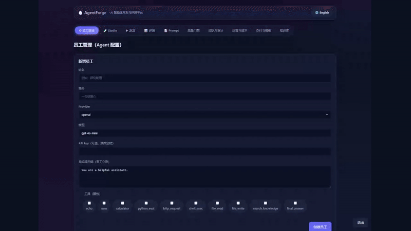
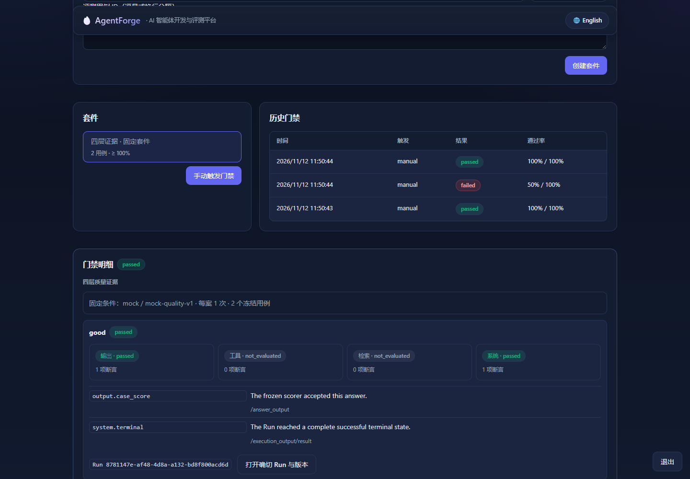
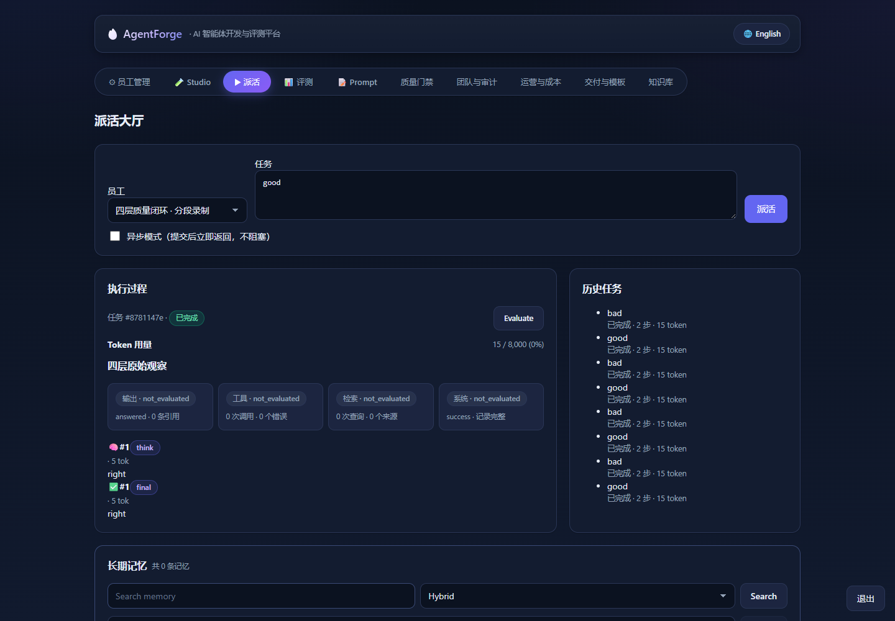
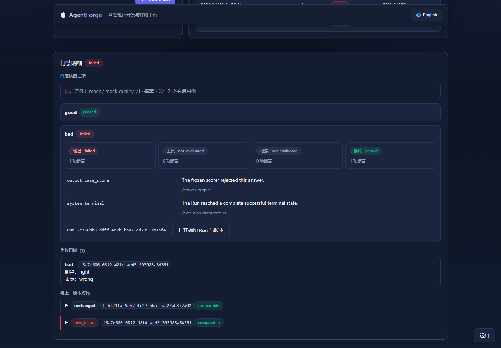
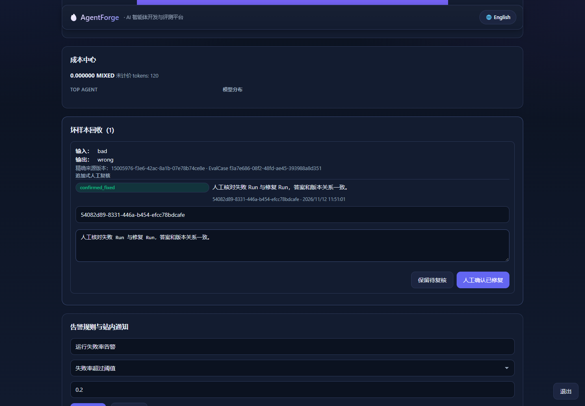
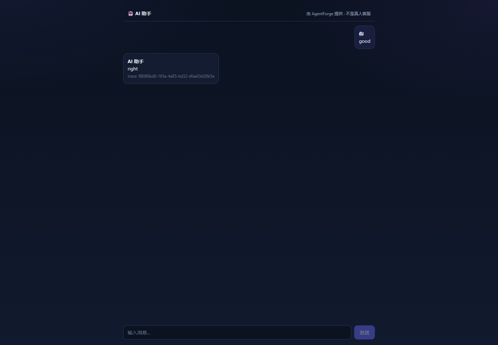

# AgentForge 产品展示

> 从 Agent 开发调试，到固定回归、质量门禁、人工复核和版本交付，在一个自托管平台中完成。

## 观看展示视频

- **[观看 / 下载 MP4](../AgentForge-demo.mp4)**：约 3 分 03 秒，中文配音、内嵌中文字幕，H.264/AAC，1280×720。
- [独立 UTF-8 字幕](../AgentForge-demo.srt)
- [GIF 预览](../AgentForge-demo.gif)
- [逐场景解说词](assets/agentforge-quality-loop/narration.json)

## 视频内容

1. **平台能力**：Agent Studio、模型与 Prompt、工具、私有知识、团队治理和多种交付方式。
2. **固定版本回归**：同一组用例贯穿三个版本，清晰呈现通过率、逐案结果与版本差异。
3. **完整执行细节**：从评测证据打开确切 Run，集中查看回答、工具、检索、系统状态与 Trace。
4. **四层问题定位**：分别观察输出、工具、检索和系统证据，快速定位配置修改带来的回归。
5. **反馈与人工复核**：将用户反馈沉淀为固定用例，并保存人工确认的修复结论。
6. **固定版本交付**：将通过验证的版本发布为 REST 接口、独立聊天页面或 iframe。

## 功能画面

### 固定版本与回归结果

### 确切 Run 的四层执行证据

### 输出与系统分层定位

### 人工修复复核

### 通过版本的公开交付

## 开始使用

按照[根目录 README](../README.md#快速开始) 即可通过 Docker Compose 或本地开发模式启动。平台默认提供可离线运行的 `mock` Provider，也可以在 Agent 配置中连接自己的模型服务。

## 制作与技术记录

展示版复用经过断言检查的真实浏览器操作片段，由 `scripts/demo/produce_quality_video.py` 合成。重新合成需要 `edge-tts`、Pillow 和 FFmpeg；脚本默认从 PATH 查找 `ffmpeg` / `ffprobe`，也可用 `AGENTFORGE_FFMPEG`、`AGENTFORGE_FFPROBE` 指定可执行文件。媒体格式、音轨、字幕和完整解码检查见[媒体验收报告](assets/agentforge-quality-loop/media-validation.json)。工程验证记录与后续迭代计划分别归档在[开发基线](planning/DEVELOPMENT_BASELINE.md)和[后续开发规划](planning/FUTURE.md)。
