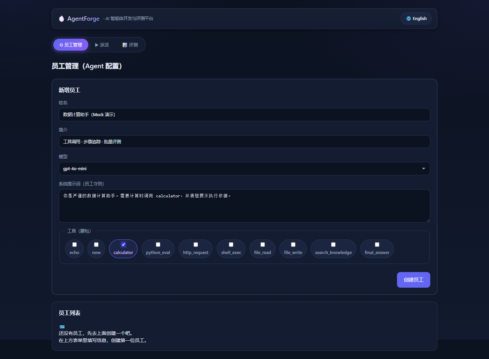
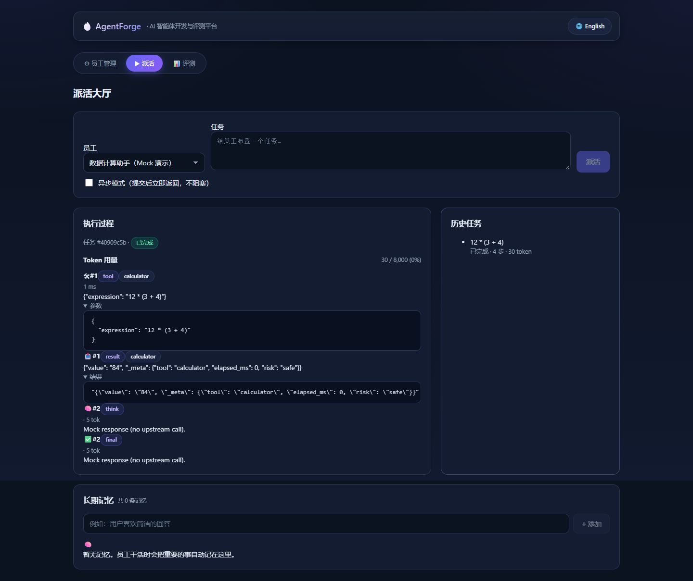
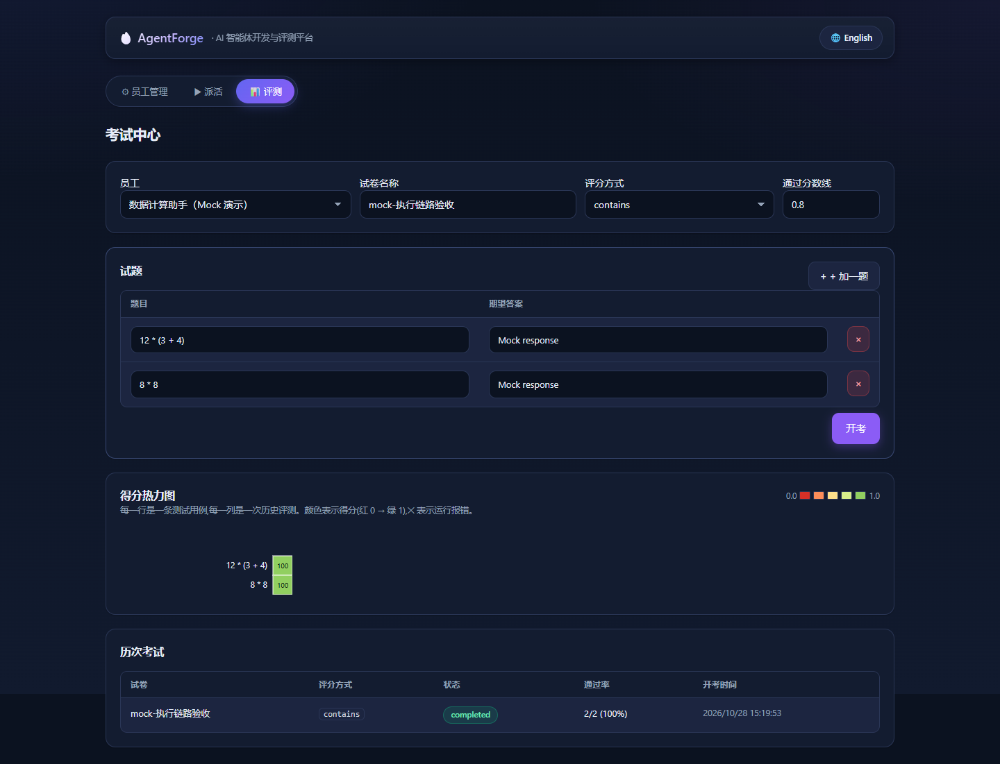

# AgentForge 项目演示

> **运行方式：**真实本地 Web UI + mock LLM。无需上游模型 API，不消耗 API 额度。
>
> **演示边界：**本页验证产品交互、工具调用、状态持久化与评测汇总。mock 提供确定性响应，因此评测结果不代表真实模型能力或生产环境准确率。

## 操作视频

[观看 / 下载 MP4 演示视频](assets/agentforge-demo/AgentForge-demo.mp4)（约 15 秒）

视频通过浏览器实际操作自动录制，流程为：创建 Agent → 选择 `calculator` → 执行任务 → 查看持久化轨迹 → 运行批量评测。

## 01 · Agent 配置与工具选择

设置系统提示词并选择 `calculator`，页面同时展示内置工具注册结果。

## 02 · 运行追踪与工具调用

提交 `12 * (3 + 4)` 后，运行轨迹依次记录工具调用、工具结果、模型响应与最终响应：

- `calculator` 参数：`{"expression":"12 * (3 + 4)"}`；
- 工具返回：`84`；
- 主流程状态：`success`，共 4 条持久化轨迹；
- 历史任务摘要同步显示已完成、4 步与 Token 用量。

## 03 · 批量评测与得分热力图

使用两条确定性 mock 链路用例验证批量执行、逐条评分、热力图和汇总状态：

- 汇总状态：`completed`；
- 通过用例：`2 / 2`；
- 页面展示数据集名称、评分器、通过率与逐用例得分。

## 本地复现

按照根目录 README 启动前后端，使用默认 `mock` provider 即可复现本演示，不需要配置真实模型密钥。
